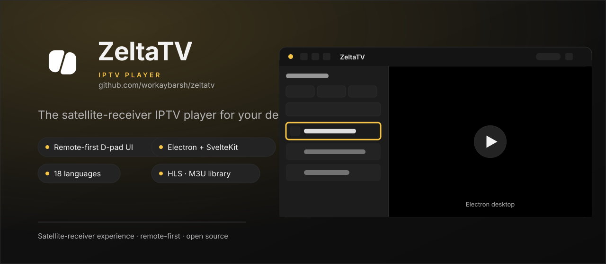
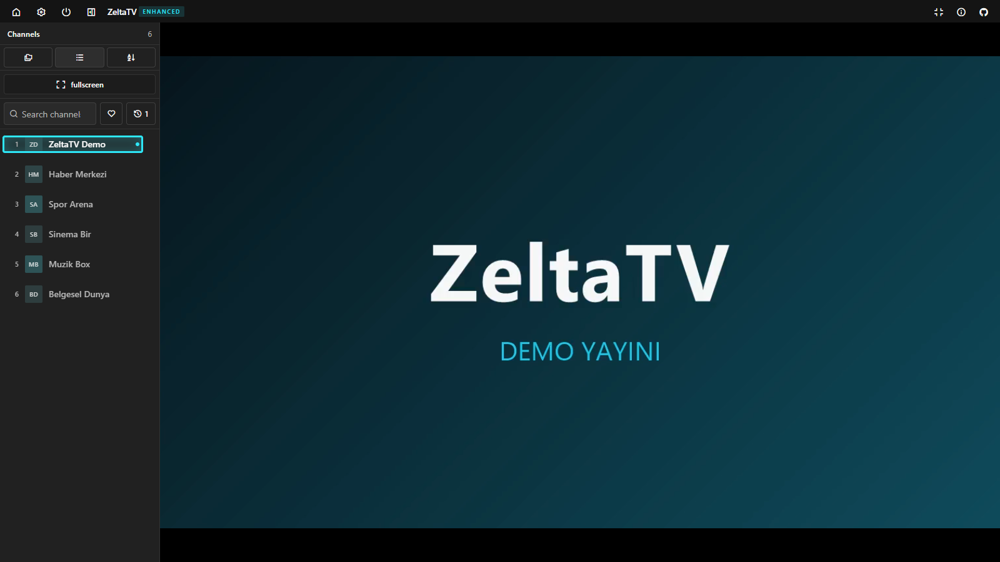
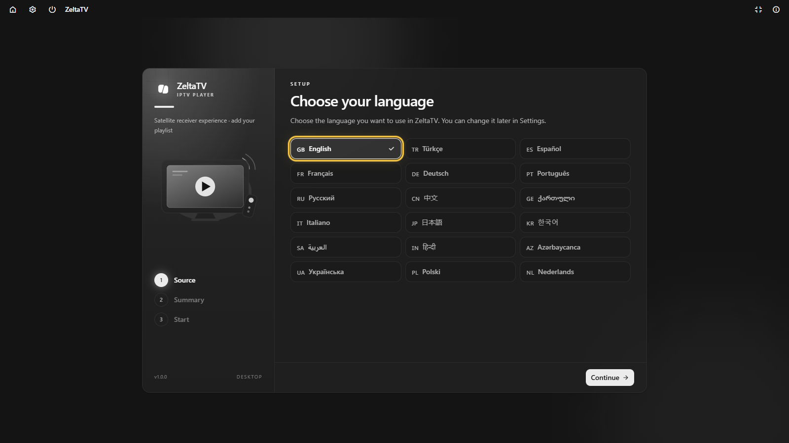
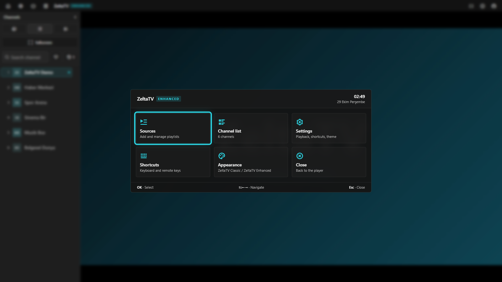
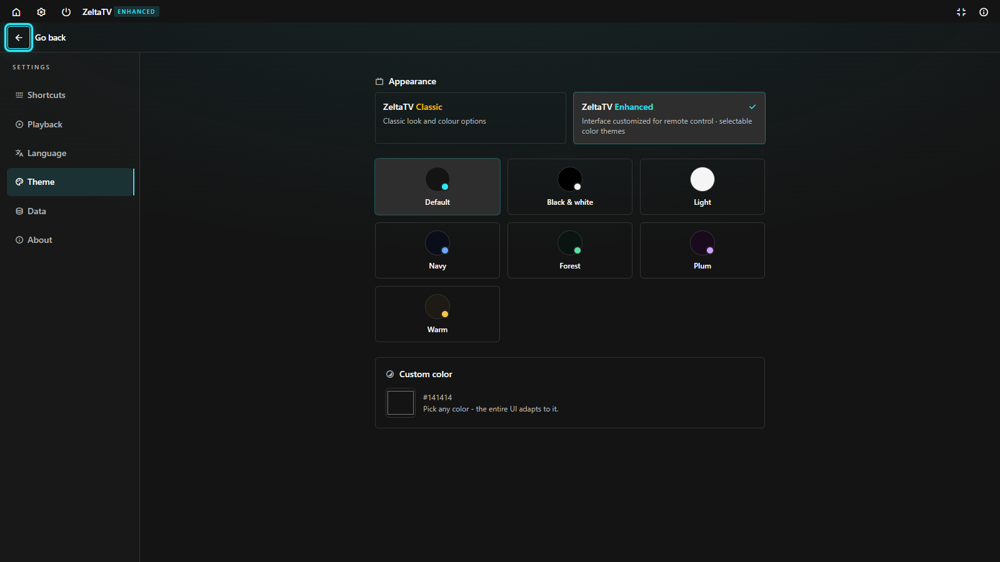
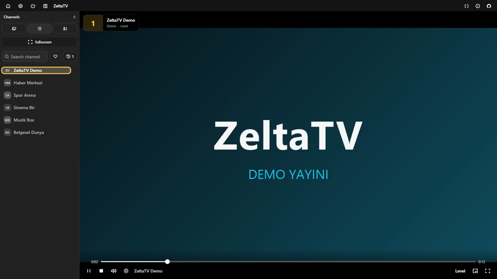

# ZeltaTV

<p align="center">
  
</p>

Desktop IPTV player for Windows, macOS and Linux. It loads your own M3U/M3U8 playlists and gives
them a satellite-receiver interface that works with a remote, a gamepad, the keyboard or a mouse.

## Download

[**Download ZeltaTV for PC**](https://github.com/zeltatv/zeltatv/releases/latest) - the Windows
installer, macOS `dmg` and Linux `deb` are attached to the latest release.

## Photo Gallery

<p align="center">
  
</p>

<!-- prettier-ignore -->
| | |
|---|---|
|  |  |
|  |  |

## Features

- D-pad, gamepad, keyboard and mouse: the whole interface works without a pointer
- Playlist library with categories; add sources by URL, local file or from the library
- Search, favourites, recently watched channels and numeric zap with an on-screen display
- HLS playback with automatic quality selection, reconnect, fullscreen and picture-in-picture
- Two looks (**Classic**, **Enhanced**) with seven shared palettes
- 18 languages, including right-to-left layouts
- Remembers the last source, channel and sidebar state

## Development

```bash
bun install            # or: npm install
bun run dev            # browser
bun run dev:electron   # desktop shell
```

Package the app:

```bash
bun run build:electron                                  # current platform
powershell -File .\scripts\build-windows-installer.ps1  # Windows Setup.exe
```

## Licence

GPL-3.0-only.
