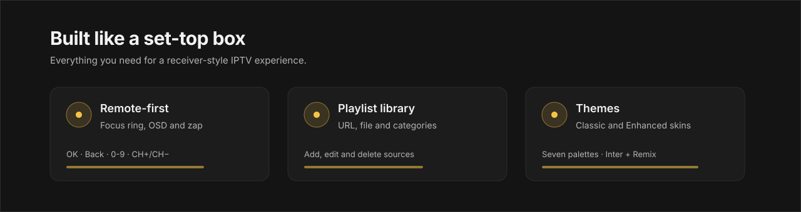

# ZeltaTV

<p align="center">
  
</p>

A cross-platform desktop IPTV player built with Electron, SvelteKit, and HLS.js. Load M3U/M3U8 playlists from URLs or local files, organise them in a library, browse channels, and stream live TV with a clean, satellite-receiver style interface.

**Current release: 1.0.0**

## Download

[**Download ZeltaTV for Windows**](https://github.com/zeltatv/zeltatv/releases/latest) — the latest
installer (Setup `.exe`, plus the dmg/deb builds) is on the releases page.

## Photo Gallery

<p align="center">
  
</p>

| | |
|---|---|
|  |  |
|  |  |

## Features

- Setup wizard that starts with a language step, then welcome, source, summary, loading and finish. Add a playlist by URL, local file, or from the library.
- Two looks: **ZeltaTV** (classic satellite receiver, default) and **Enhanced**, both with the same colour themes.
- Channel-number OSD with a black card and white digits.
- Channel banner when zapping, idle auto-hide of cursor and controls in fullscreen.
- One-click fullscreen button in the sidebar, below the sort controls.
- Default channel order follows the playlist order; grouped and alphabetical views are optional.
- Search, favourites and recently watched channels.
- Playlist library with categories. Add, edit, delete and quick-start sources.
- Adaptive HLS quality with "always highest quality" playback setting and automatic reconnect.
- Settings persist across restarts: theme, skin, language, shortcuts, player preference, sidebar state, last playlist and last channel.
- 18 languages.
- All common "back" keys work: Backspace, Esc, BrowserBack, Alt+Left, context-menu key, right-click, mouse side button.
- Optional NVIDIA overlay mitigation flags (`ZELTATV_ANGLE`, `ZELTATV_NO_DCOMP`).

<p align="center">
  
</p>

## Requirements

- [Bun](https://bun.sh) runtime (or npm)
- Node.js 18+ (for Electron)

## Installation

Grab the prebuilt Windows installer from the repository's Releases page, or build from source:

```bash
git clone https://github.com/zeltatv/zeltatv.git
cd zeltatv
bun install   # or: npm install
```

## Development

Run the web dev server:

```bash
bun run dev
```

Run with Electron (launches Vite + Electron together):

```bash
bun run dev:electron
```

## Build

Build the web assets:

```bash
bun run build
```

Build the desktop app for your current platform:

```bash
bun run build:electron
```

### Windows installer

The Windows release uses a step-by-step Inno Setup wizard with the GPL-3.0 licence page,
install-directory choice and a cancel path. The installer is English-only; ZeltaTV asks for the
interface language on first launch. Install
[Inno Setup 6](https://jrsoftware.org/isdl.php), then run:

```powershell
powershell -ExecutionPolicy Bypass -File .\scripts\build-windows-installer.ps1
```

Output: `release/ZeltaTV-<version>-Setup.exe`. The "Launch ZeltaTV" box on the finish page is
left unchecked, so the wizard closes as soon as the files are written; the app's own setup screen
starts on the first launch and can be skipped with **Set up later**.

## License

This project is licensed under [GPL-3.0](LICENSE).
